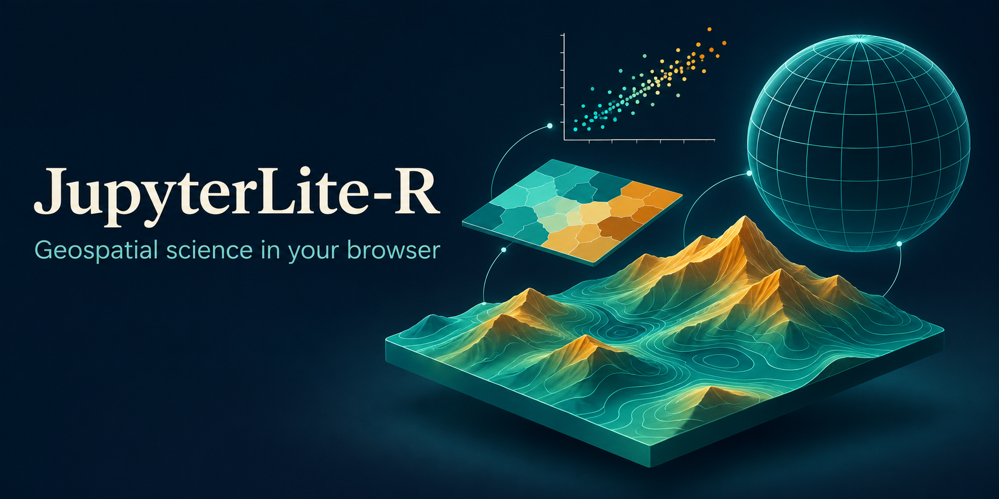

# JupyterLite-R



**Geospatial science in your browser. From your first map to a reproducible spatial evidence brief.**

Explore R through a Jupyter Book and a browser-based JupyterLite Lab: build **2D maps**, inspect
**3D terrain**, compose **3D scenes**, rotate **globes**, and connect **data visualizations** to
careful statistical reasoning. Every teaching dataset and geographic shape in this starter
collection is generated from original code. No installation of R is needed for readers using Lab.

[**Launch the R Shiny spatial explorer ↗**](https://jltobias.github.io/JupyterLite-R/shiny/)
— change the threshold, palette, and seed; inspect the map, distribution, and selected sites; download the data.

| Read | Run | Explore |
| --- | --- | --- |
| [**Open the Jupyter Book →**](https://jltobias.github.io/JupyterLite-R/book/) | [**Launch R Lab ↗**](https://jltobias.github.io/JupyterLite-R/lite/lab/index.html?path=01-browser-laboratory.ipynb) | [**Open the visual gallery ↗**](https://jltobias.github.io/JupyterLite-R/gallery/) |

**Publication status:** published on GitHub Pages and checked on **2026-11-17**.
The [deployment succeeded](https://github.com/jltobias/JupyterLite-R/actions/runs/44159085025),
and the public Shiny app passed browser checks for its controls and CSV download.
See the [validation record](validation/RESULTS.md) for tested behavior and remaining limits.
The [upstream webR Lab demo](https://jupyter.r-wasm.org/) is an independent example of the kernel;
it does not contain this textbook's chapters.

## A textbook you can experiment with

Each chapter has a motivating question, learning objectives, reproducible R code, assertions,
interpretation, exercises, a checkpoint, and references. The collection is a substantive starting
point for a growing textbook, not a complete treatment of geospatial data science.

| Chapter | What you investigate | Packages and tools | Notebook |
| --- | --- | --- | --- |
| 1 · Browser laboratory | Seeds, spatial fields, browser storage, runtime provenance | Base R, webR | [Read](notebooks/01-browser-laboratory.ipynb) · [Run](https://jltobias.github.io/JupyterLite-R/lite/lab/index.html?path=01-browser-laboratory.ipynb) |
| 2 · Color and choropleths | Counts versus rates; equal intervals versus quantiles; missingness | Base R, **RColorBrewer** extension | [Read](notebooks/02-color-and-choropleths.ipynb) · [Run](https://jltobias.github.io/JupyterLite-R/lite/lab/index.html?path=02-color-and-choropleths.ipynb) |
| 3 · Vector geometry | Coordinate systems, point-in-polygon, units, audited joins | Base R, **sf** extension | [Read](notebooks/03-vector-geometry.ipynb) · [Run](https://jltobias.github.io/JupyterLite-R/lite/lab/index.html?path=03-vector-geometry.ipynb) |
| 4 · Terrain and rasters | A landscape equation, contour maps, slopes, raster orientation | Base R; **terra** desktop extension | [Read](notebooks/04-terrain-and-rasters.ipynb) · [Run](https://jltobias.github.io/JupyterLite-R/lite/lab/index.html?path=04-terrain-and-rasters.ipynb) |
| 5 · 3D scenes | Terrain plus a fictional drone route; clearance and occlusion | R `persp` / `trans3d`; gallery | [Read](notebooks/05-three-dimensional-scenes.ipynb) · [Run](https://jltobias.github.io/JupyterLite-R/lite/lab/index.html?path=05-three-dimensional-scenes.ipynb) |
| 6 · Globes | Unit vectors, great circles, spherical distance, projection | Base R; interactive globe | [Read](notebooks/06-globes-and-great-circles.ipynb) · [Run](https://jltobias.github.io/JupyterLite-R/lite/lab/index.html?path=06-globes-and-great-circles.ipynb) |
| 7 · Spatial dependence | Moran's I, permutation reference distributions, neighbor sensitivity | Base R, **spdep** extension | [Read](notebooks/07-spatial-dependence.ipynb) · [Run](https://jltobias.github.io/JupyterLite-R/lite/lab/index.html?path=07-spatial-dependence.ipynb) |
| 8 · Linked micromaps | Ranked estimates, Wilson intervals, original custom border groups | Base R, **micromapST + sf** extension | [Read](notebooks/08-linked-micromaps.ipynb) · [Run](https://jltobias.github.io/JupyterLite-R/lite/lab/index.html?path=08-linked-micromaps.ipynb) |
| 9 · Evidence brief | Threshold sensitivity, measurement perturbations, reproducible reporting | Base R, **ggplot2** extension | [Read](notebooks/09-capstone.ipynb) · [Run](https://jltobias.github.io/JupyterLite-R/lite/lab/index.html?path=09-capstone.ipynb) |
| 10 · Reactive maps with Shiny | Controls, cached reactive expressions, maps, tables, and CSV downloads | **Shiny + Shinylive**, base R model | [Read](notebooks/10-reactive-maps-with-shiny.ipynb) · [Open app](https://jltobias.github.io/JupyterLite-R/shiny/) |

The [gallery](gallery/index.html) offers a contour map, rotatable terrain, a layered flight scene,
a mathematical globe, and a ranked data view. Its downloadable CSV files are computed by the R
chapters. There are no copied basemaps, satellite textures, map tiles, or real-world boundaries.

## How it works

[JupyterLite](https://jupyterlite.readthedocs.io/) supplies the browser notebook environment.
[webR](https://docs.r-wasm.org/webr/latest/) runs R as WebAssembly on the reader's device, and
[jupyterlite-webr](https://github.com/r-wasm/jupyterlite-webr-kernel) connects it to notebooks.
[Jupyter Book 2](https://jupyterbook.org/stable/) builds the reading experience from the same
notebook files using MyST. The site is static; it needs no server-side R session.

The initial application, runtime, and package downloads require a connection. Browser storage is
not a backup: download edited notebooks regularly. These examples use small synthetic datasets
to keep computation inspectable and memory use modest.

**Browser compatibility is explicit.** The core lessons use base R. Extensions check for installed
packages and report when they are skipped. Install intentionally in a separate Lab cell, for example
`webr::install("RColorBrewer")`, then rerun the extension. A CRAN listing or successful desktop
installation does not guarantee a compatible WebAssembly binary. The package repository is live,
so record `sessionInfo()` and `citation("packageName")` for each analysis.
See the [compatibility guide](book/compatibility.md) and [validation evidence](validation/RESULTS.md).

In the tested webR 0.5.1 runtime, `terra` failed and is explicitly a desktop extension. `micromapST`
uses an original prebuilt border group in Lab to avoid its V8-dependent border-construction step.
Regenerate that small fixture in desktop R with `Rscript tools/export_border.R` after installing
the optional packages. It contains only this project's twelve synthetic square districts.

The pinned kernel displays PNG graphics and text; general HTML-widget output and widget comms are
not implemented in its [display path](https://github.com/r-wasm/jupyterlite-webr-kernel/blob/main/src/webr_kernel.ts).
The separate Plotly.js gallery provides interactive 3D rendering of saved R-generated geometry.
Notebook edits do not automatically update the gallery; its exports must be regenerated.

The original [Shiny app](shiny/app/app.R) runs on a separate **Shinylive** page rather than inside
the notebook kernel. [Shinylive for R](https://posit-dev.github.io/r-shinylive/) exports R Shiny
apps for static hosting and runs their R computation in the reader's browser. Chapter 10 explains
the model and reactive dependencies. Its exporter manages a separate runtime/assets version.

## Build and publish

Use Python 3.12 or 3.13, Node.js 22, and R. Native R exports the Shiny app during the site build
and also validates chapters and regenerates numerical previews. Readers need only a browser.

```sh
python -m venv .venv
# Activate: Windows PowerShell: .venv\Scripts\Activate.ps1
# Activate: macOS/Linux: source .venv/bin/activate
python -m pip install -r requirements.txt
Rscript tools/install_shiny.R
python tools/check_content.py
python tools/build.py
python tools/serve.py
```

Open **http://127.0.0.1:8000/**. The preview server sends the isolation headers needed by webR.
If Rscript is not on PATH, pass `--rscript /path/to/Rscript` to `tools/build.py`.
Opening HTML directly from disk is not supported. To simulate a host without headers and test the
Lab isolation worker, use `python tools/serve.py --no-isolation`.

For GitHub Pages:

1. Commit and push the repository contents to `main`.
2. In **Settings → Pages**, set **Source → GitHub Actions**.
3. Let [the workflow](.github/workflows/pages.yml) validate the notebooks, build the Book and Lab,
   and deploy the combined `_site` artifact. Inspect its deployment URL and test a fresh browser session.

The workflow also builds pull requests without deploying them. It uses a repository-relative base
URL; a local equivalent is `python tools/build.py --base-url /JupyterLite-R` (serve that artifact
under the matching path). If you fork under a different account or repository name, update the
absolute launch links in the README, chapter sources, Book intro, and `myst.yml`.

## Authoring and verification

```sh
# Edit chapters/*.R: # %% begins a code cell, # %% [markdown] begins prose.
python tools/make_notebooks.py
python tools/validate_notebooks.py --rscript /path/to/Rscript --embed
python tools/check_content.py

# Optional, deliberate desktop-package setup, in a private project library:
Rscript tools/install_r_extensions.R
python tools/validate_notebooks.py --rscript /path/to/Rscript --extensions

# Regenerate the numerical gallery assets from the R chapters:
Rscript tools/export_gallery.R

# Test the companion Shiny model and reactive server, or export it alone:
Rscript tools/test_shiny.R
Rscript tools/export_shiny.R
```

`--embed` saves native-R core outputs for readers; it does not certify browser execution. Validation
records code hashes, cell logs, plots, and session details under `validation/runs/`. Optional package
checks are separate from the core suite. The [test report](validation/RESULTS.md) distinguishes these
from browser checks. The build pins the Lite/Lab/kernel generation together; upgrade them as a tested
set. Upstream templates and package repositories can still change, so this is not a fully hermetic build.

| Location | Purpose |
| --- | --- |
| `chapters/` | Reviewable R sources with Markdown teaching narrative |
| `notebooks/` | Generated, portable `.ipynb` chapters used by both Book and Lab |
| `book/`, `myst.yml` | Book introduction, compatibility notes, references, and navigation |
| `gallery/` | Interactive figures and original R-generated CSV inputs |
| `shiny/app/` | Original R Shiny application and testable simulation model |
| `assets/` | Original splash image and creation provenance |
| `tools/`, `web/` | Build, validation, local serving, and original Lab isolation bootstrap |
| `.github/workflows/pages.yml` | Automated validation and Pages deployment |

## Citations and attributions

**Content policy:** no third-party creative artwork, publication figures, prose passages, imagery,
basemaps, or geographic datasets are copied into the teaching material. The splash is an original
AI-generated illustration; its [creation record](assets/PROVENANCE.txt) includes the prompt and tool.
All observations and boundaries are synthetic and generated by the original R code.

Open-source software is generally copyrighted and licensed for reuse. This project depends on it,
including the R packages requested here; it does **not** describe those dependencies as copyright-free.
The [CC0 dedication](LICENSE) covers this project's original materials to the extent rights can be
waived, and does not replace any upstream license. Built distributions retain upstream software,
icons, fonts, and license notices. No project logo or third-party illustration is used in the splash.

| Resource | Attribution and reference | License / role |
| --- | --- | --- |
| R | R Core Team. [R Project](https://www.r-project.org/); obtain the installed citation with `citation()` | GPL-2 or GPL-3; statistical runtime |
| JupyterLite / JupyterLab | Jupyter contributors. [JupyterLite](https://github.com/jupyterlite/jupyterlite), [JupyterLab](https://github.com/jupyterlab/jupyterlab) | BSD-3-Clause; application and interface |
| webR | George Stagg and webR contributors. [Source and license](https://github.com/r-wasm/webr) | GPL-3.0; R compiled for WebAssembly, with upstream components |
| webR kernel | George Stagg and contributors. [jupyterlite-webr-kernel](https://github.com/r-wasm/jupyterlite-webr-kernel) | MIT; R notebook kernel |
| Jupyter Book / MyST | Executable Books and MyST contributors. [Book](https://jupyterbook.org/stable/), [MyST](https://mystmd.org/) | MIT; textbook tooling |
| RColorBrewer / ColorBrewer | Erich Neuwirth; palette designs by Cynthia Brewer, Mark Harrower, and collaborators. [Package DOI](https://doi.org/10.32614/CRAN.package.RColorBrewer), [ColorBrewer](https://colorbrewer2.org/) | Apache-2.0 package; palettes obtained from the installed package |
| sf | Pebesma (2018), *Simple Features for R*. [DOI](https://doi.org/10.32614/RJ-2018-009) | GPL-2 or MIT; geometry and coordinates |
| terra | Robert J. Hijmans and contributors. [Package DOI](https://doi.org/10.32614/CRAN.package.terra) | GPL-3; raster extension |
| spdep | Bivand and Wong (2018), *Comparing implementations of global and local indicators of spatial association*. [DOI](https://doi.org/10.1007/s11749-018-0599-x) | GPL-2 or GPL-3; Moran comparison |
| micromapST | Pickle, Pearson and Carr (2015), *micromapST: Exploring and Communicating Geospatial Patterns in US State Data*, JSS 63(3). [DOI](https://doi.org/10.18637/jss.v063.i03), [CRAN](https://cran.r-project.org/package=micromapST) | GPL ≥2; linked micromaps using our own border group |
| ggplot2 | Hadley Wickham and contributors. *ggplot2: Elegant Graphics for Data Analysis* (2016). [Project](https://ggplot2.tidyverse.org/) | MIT; optional data visualization |
| Plotly.js | Plotly contributors. [Source / MIT notice](https://github.com/plotly/plotly.js/blob/v3.1.0/LICENSE) | MIT; gallery library loaded from CDN, no third-party data |
| Shiny / Shinylive | Posit and contributors; Shinylive R authors Barret Schloerke, Winston Chang, George Stagg, and Garrick Aden-Buie. [Shiny](https://shiny.posit.co/), [Shinylive R](https://posit-dev.github.io/r-shinylive/) | MIT; reactive application and static exporter; upstream runtime dependencies retain their licenses |
| Wilson intervals | E. B. Wilson (1927), *Probable Inference, the Law of Succession, and Statistical Inference*. [DOI](https://doi.org/10.1080/01621459.1927.10502953) | Method reference only; no publication material reproduced |
| Spatial package discovery | [R-spatial projects](https://r-spatial.org/projects/), [CRAN Spatial Task View](https://cran.r-project.org/view=Spatial) | Reference directories; not browser-compatibility certification |

Use [CITATION.cff](CITATION.cff) to cite this repository, and cite the versions of the packages you
actually use. Longer bibliographic entries are in [the Book references](book/references.md).

## Grow the book

Next directions include `gstat` for variograms and spatial prediction, `stars` for data cubes,
`sfnetworks` for networks, and `tmap` / `leaflet` for web cartography. Before adding a chapter,
verify both WebAssembly package availability and the display mechanism. Include a small reproducible
dataset with explicit rights, units and coordinate metadata, numerical checks, accessible text
alternatives, and an honest account of uncertainty. Real-world data lessons should maintain an
asset-by-asset source and license ledger.
