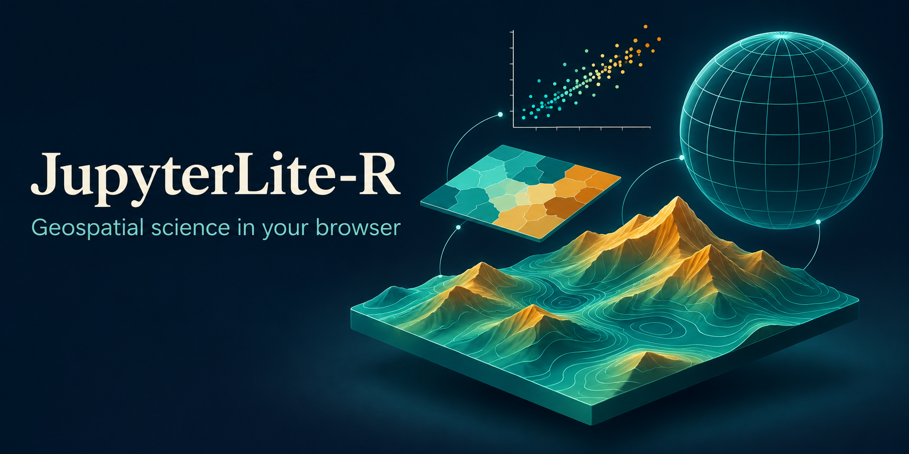

# Geospatial science in your browser

**Start with a question. Build a map. Inspect the evidence.**

This growing textbook teaches geospatial reasoning through small, reproducible R experiments.
Read the chapters here, then follow each chapter's **Open in Lab** link to change the code.
JupyterLite and webR run R on your computer inside the browser. You need a connection for the
initial application, runtime, and package downloads.

[Open R Lab](https://jltobias.github.io/JupyterLite-R/lite/lab/index.html?path=01-browser-laboratory.ipynb)
· [Explore the interactive gallery](https://jltobias.github.io/JupyterLite-R/gallery/)
· [Source repository](https://github.com/jltobias/JupyterLite-R)

## How to use the book

1. Start with Chapter 1 and select **R (webR)** in Lab.
2. Run cells from top to bottom. Read assertions and numeric results alongside the graphics.
3. Work through each chapter's practice tasks and compare against its checkpoint.
4. Install optional packages deliberately, following the compatibility guide.
5. Download your edited notebooks before closing or clearing browser storage.

Saved figures in this book come from native R core execution, with their provenance recorded in
the notebooks. Running a notebook in Lab replaces those outputs with your own browser execution.
Optional extension cells are presented as executable explorations; their saved outputs are not
included in the core preview. Desktop and browser testing are reported separately.

## What you will learn

The ten chapters progress from reproducible simulation through color and classification,
coordinate systems and joins, rasters and 3D surfaces, scene composition, spherical geometry,
spatial dependence, linked micromaps, a sensitivity-analysis capstone, and an R Shiny application. The examples are
small enough to inspect. They use base R graphics for a compact browser core and introduce
`RColorBrewer`, `sf`, `terra`, `spdep`, `micromapST`, and `ggplot2` through explicit extensions.

All teaching observations, boundaries, terrain, and route coordinates are original simulations.
They demonstrate techniques, not empirical findings. The splash is original AI-generated artwork;
it is illustrative rather than an analytical map. The interactive gallery uses numerical exports
from R and Plotly.js; see the source repository's attribution inventory.

## The textbook is a foundation

These are substantive starter chapters, not a complete survey of spatial statistics. Subsequent
chapters can introduce spatial prediction, network analysis, data cubes, and reproducible workflows
with licensed real observations. Every addition should state data provenance, units, uncertainty,
browser compatibility, and what was actually tested.
